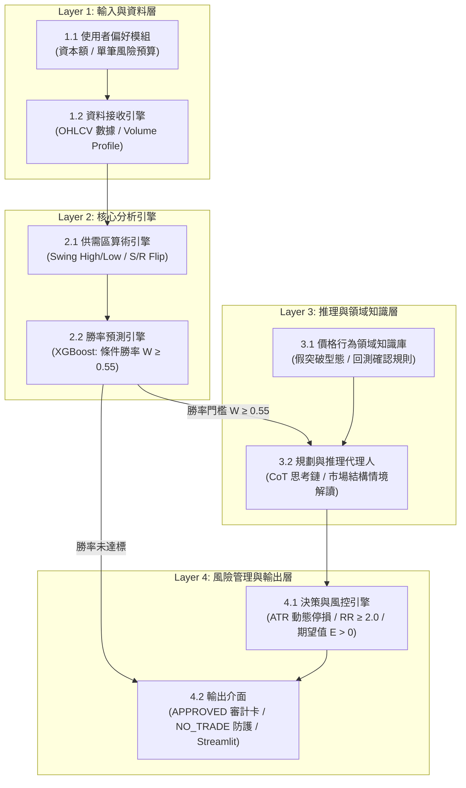

# Hybrid TPA-Agent: 混合式短線交易智慧代理人系統
> **Decoupled Architecture: Deterministic Geometry + Walk-Forward ML + CoT LLM + Veto Risk Gate**

[](https://www.python.org/downloads/)
[](https://opensource.org/licenses/MIT)
[](#系統架構)
[](https://github.com/ping29065147/Hybrid-TPA-Agent)

---

## 專案核心摘要 (300 字標準摘要)

短線交易者須在有限時間內整合價格波動、技術指標、交易成本及市場風險，容易受到資訊過載與主觀判斷影響。過去研究亦顯示，個人短線交易者長期獲利並不容易，凸顯建立客觀且具風險控管能力之決策輔助系統的必要性。然而，傳統技術指標難以完整辨識價格結構，機器學習模型容易受到市場非平穩性及過度擬合影響，而大型語言模型（LLM）則可能產生錯誤推論，難以獨立負責精確數值運算。

本專題提出 **Hybrid TPA-Agent（混合式短線交易智慧代理人系統）**，整合確定性演算法、機器學習與大型語言模型，建立可解釋且風控優先的人機協作決策架構。系統首先利用歷史開盤、最高、最低、收盤價及成交量（OHLCV）資料，透過演算法辨識波段高低點、供需區及支撐壓力轉換，並計算平均真實波幅（ATR）等技術特徵。接著使用極端梯度提升模型（XGBoost）評估突破與反彈訊號品質，再由 LLM Agent 結合結構化資料及領域知識，生成交易情境分析與可解釋報告。最後透過獨立風險管理引擎設定停損、風險報酬比、流動性門檻及異常交易限制，必要時主動輸出不交易（`NO_TRADE`）建議，並保留人工確認機制。

開發採用 Python、Pandas、NumPy、XGBoost、LLM 及 Streamlit 等工具，完成資料處理、特徵工程、模型訓練、Agent 推理、風控及互動展示平台。實驗比較傳統移動平均線、相對強弱指標、隨機策略、單一機器學習模型、單一 LLM 與完整混合架構，並透過滾動時間序列驗證（Walk-forward Validation）、消融實驗及納入手續費與滑價的回測，評估獲利能力、最大回撤、夏普比率、勝率及訊號品質。

本研究預期建立一套兼具分析能力、決策透明度及風險控管機制的智慧交易輔助系統，驗證混合式 AI 架構是否能降低低品質交易訊號，改善交易決策品質及風險調整後績效，而非單純追求價格預測或保證交易獲利。

---

## 專題學術論證架構 (A to F Framework)

### A. Attention Getter (背景引入與痛點吸引)
在瞬息萬變的短線交易市場中，交易者每天都必須面對海量的即時行情與複雜的 K 線圖表。然而，人類操盤手在緊迫的時間壓力下，往往難以同時精準完成市場結構標記、勝率評估與風險報酬比計算，甚至容易受到恐懼與貪婪等心理情緒干擾而做出非理性決策。實證研究顯示（Chague et al., 2019），在持續交易逾 300 天的當沖客中，高達 **97% 最終虧損**，且交易經驗並未隨時間穩定轉化為獲利能力。FINRA 亦警告，當沖可能因槓桿、流動性不足、系統故障與高頻摩擦成本而導致全部資金損失。如何建立一套既能敏銳洞察市場結構、又具備嚴謹數學與風控紀律的 AI 交易輔助系統，成為現代金融科技的重要課題。

### B. But (現有方法的挑戰與研究缺口)
現有自動化交易與 AI 方案各自存在無法克服的短板：
1. **傳統指標型量化與純 ML 模型**：擅長數值統計，但指標滯後，且完全缺乏對圖表「幾何空間結構」與多時間框架情境的推理能力，盤整期雜訊過多。
2. **純大型語言模型代理人 (LLM Trading Agents)**：具備文字語意與新聞解讀力，但數值推理精度低、空間幾何感知差，直接分析 K 線會產生嚴重的「空間與數值幻覺」，導致部位計算失真。
3. **自動化支撐壓力工具 (KDE / Pivot)**：僅能提供靜態水平線，缺乏後續突破/反彈的機率預測與動態風控評估。

### C. Cure (核心解藥：混合解耦架構)
Hybrid TPA-Agent 的核心理念為「**讓每個元件只做它最擅長的事**」：
- **確定性演算法**：負責 100% 精確的空間幾何運算（波段高低點、供需區、ATR），杜絕空間幻覺。
- **機器學習 (XGBoost)**：在嚴格防洩漏條件下，負責計算客觀條件突破/反彈勝率 $W$。
- **LLM Agent**：結合 Price Action 領域知識庫進行 CoT 情境推理與風險敘事生成。
- **獨立風控引擎**：手握最高否決權（Veto Power），嚴格檢驗 $E > 0$ 與 $RR \ge 2.0$，必要時堅決輸出 `NO_TRADE`。

### D. Development (四層八模組系統架構)


### E. Experiments (實驗設計與評估矩陣)
- **多標的長週期資料**：涵蓋主要加密貨幣、美股權值股與指數 ETF。
- **Walk-Forward Validation**：滾動窗口時間序列驗證，嚴格依時間先後劃分，禁止隨機切分，防範未來數據洩漏。
- **六大多維 Baseline**：Buy-and-Hold、隨機策略、MA Crossover、RSI 策略、XGBoost-only、LLM-only。
- **評估指標**：淨年化報酬、夏普比率（Sharpe）、最大回撤（MDD）、淨期望值 $E$、實際實現 RR，以及 0~20 bps 之手續費與滑價敏感度曲線。

### F. Findings (預期產出與專案貢獻)
1. **高信噪比交易決策系統**：濾除無效訊號，產出具備完整證據鏈的結構化審計報告。
2. **幾何結構與機器學習融合範式**：成功將主觀技術分析轉化為可審計之確定性特徵。
3. **模組化開源程式碼庫**：提供完整規格書（[DESIGN.md](DESIGN.md)）、單元測試與 Streamlit 互動平台。

---

## 專案目錄結構

```
Hybrid-TPA-Agent/
├── README.md                      # 專案主說明文件
├── DESIGN.md                      # 完整系統架構與資料合約規格書
├── INFOGRAPHIC_A4.md              # 高密度 NUMBERING A4 橫式資訊圖表規格
├── requirements.txt               # Python 依賴清單
├── .gitignore                     # Git 忽略設定
├── setup_github.ps1               # 一鍵連接與推送 GitHub 輔助腳本
├── docs/
│   ├── literature_review.md       # 最新學術文獻、FINRA 監管數據與案例庫
│   └── infographic_a4_landscape.html # 視覺化 A4 橫式高密度資訊圖表
├── src/
│   ├── layer1_data/               # L1: 資料接收與使用者偏好
│   │   ├── data_loader.py
│   │   └── user_profile.py
│   ├── layer2_core_engine/        # L2: 確定性空間幾何與 XGBoost 機率
│   │   ├── swing_detector.py
│   │   ├── supply_demand.py
│   │   └── xgb_predictor.py
│   ├── layer3_reasoning/          # L3: 領域知識庫與 CoT 推理 Agent
│   │   ├── price_action_kb.py
│   │   └── cot_planner.py
│   └── layer4_risk_output/        # L4: 動態 ATR 風控、熔斷降級與輸出
│       ├── risk_manager.py
│       └── report_generator.py
├── tests/
│   ├── test_geometry.py           # 幾何演算法單元測試
│   └── test_risk_manager.py       # 風控與期望值單元測試
└── app.py                         # Streamlit 互動式決策原型系統
```

---

## 快速上手與執行

### 1. 安裝環境
```bash
# 建議建立虛擬環境
python -m venv venv
# 啟動虛擬環境 (Windows PowerShell)
.\venv\Scripts\Activate.ps1
# 安裝相依套件
pip install -r requirements.txt
```

### 2. 執行單元測試
```bash
pytest tests/
```

### 3. 啟動 Streamlit 互動決策儀表板
```bash
streamlit run app.py
```

---

## 連接你的 GitHub (GitHub Setup)

本機目前已為你配置好 Git 使用者設定：
- **用戶名稱 (Name)**: `ping29065147`
- **電子郵件 (Email)**: `pinghe.yeh@gmail.com`

### 快速推送到 GitHub 步驟：
1. 請至 [GitHub.com/new](https://github.com/new) 建立一個名為 `Hybrid-TPA-Agent` 的儲存庫（Repository）。
2. 在本專案目錄下執行以下指令（或直接執行 `./setup_github.ps1`）：
```powershell
git remote add origin https://github.com/ping29065147/Hybrid-TPA-Agent.git
git branch -M main
git push -u origin main
```
